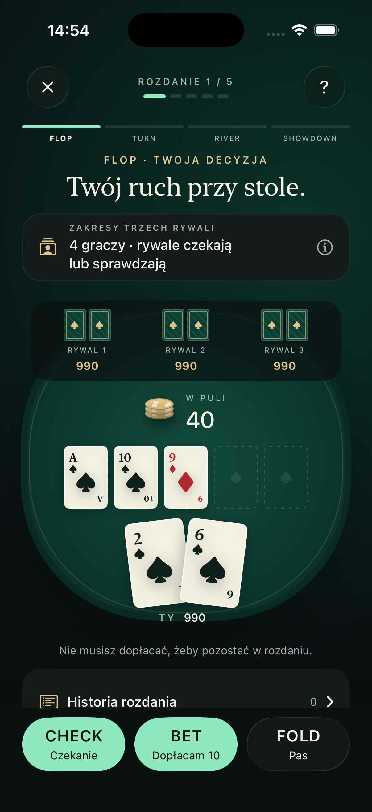
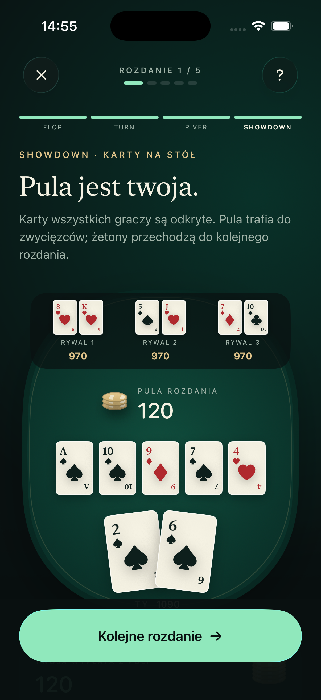
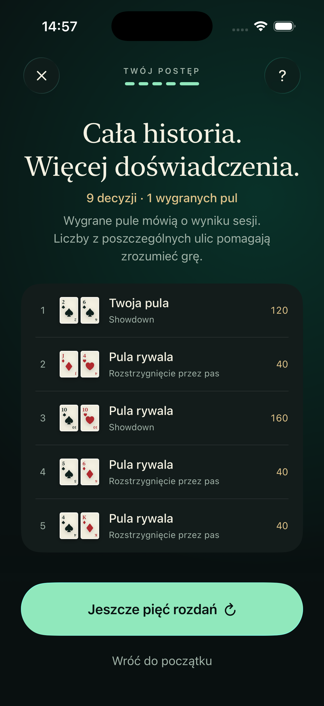

<h1 align="center">♠ Modern Poker</h1>

<p align="center">
  <strong>A poker table built for learning.</strong><br />
  Play a complete hand. Review each decision. See how the cards change your odds.
</p>

<p align="center">
  
  
  
  
</p>

<p align="center">
  <a href="#at-the-table">Screenshots</a> ·
  <a href="#the-experience">Features</a> ·
  <a href="#run-the-app">Run the app</a> ·
  <a href="#connect-the-backend">Backend</a> ·
  <a href="#inside-the-numbers">The math</a>
</p>

Modern Poker is a native iPhone Texas Hold’em trainer with **five complete hands per session**, decisions on every street, and feedback based on the information available when you acted. Play against three opponents through the Poker Tutor backend, or train offline against one local opponent.

## At the table

<table>
  <tr>
    <th align="center">01 · Your decision</th>
    <th align="center">02 · The showdown</th>
    <th align="center">03 · Your session</th>
  </tr>
  <tr>
    <td align="center"></td>
    <td align="center"></td>
    <td align="center"></td>
  </tr>
  <tr>
    <td align="center">Read the board.<br />Choose your move.</td>
    <td align="center">Reveal every hand.<br />Follow the payout.</td>
    <td align="center">Review five hands.<br />Keep learning.</td>
  </tr>
</table>

*Actual iPhone 17 Pro simulator screenshots captured with RocketSim during the backend integration demo. The app interface is currently in Polish; this README is in English.*

## The experience

- **One hand, every street.** Your hole cards stay fixed as the board progresses from flop to turn, river, and showdown. Continue after reviewing each decision.
- **Feedback after your move.** See equity, uncertainty, and an explanation of the decision. Backend mode also shows a recommendation, decision grade, check/bet EV, and the probability of winning without splitting the pot.
- **Disclosed opponent ranges.** Inspect the assumed range for each opponent before acting. Teaching equity uses those ranges and the public board.
- **A table with motion.** Emerald felt, ivory cards, champagne accents, native Liquid Glass controls, staged card dealing, chip flights, haptics, and celebrations.
- **Five hands, one session.** Count completed hands rather than button taps. Backend balances carry into the next hand, including fractional split-pot payouts.
- **Visible network recovery.** A lost action response is recovered from the server’s saved state. Remote failures remain visible; the app never silently switches to offline data.

### Two ways to play

| | Backend training | Offline training |
| --- | --- | --- |
| Table | You + three opponents | You + one opponent |
| Decisions | CHECK · BET 10 · FOLD | CHECK · CALL · BET · RAISE · FOLD, as legal |
| Opponent policy | Check or call | Bet 50 on flop, check turn, bet half-pot on river; call your bets/raises |
| Analysis | Server estimates, recommendations, and decision grades under the check-down model | On-device Monte Carlo equity and call-price benchmarks |
| Hand ending | Showdown or fold with a separate hypothetical review | Showdown, fold, or an all-in runout |
| Connection | Poker Tutor API | None required |

All chips are virtual. Deals do not depend on previous results or how often you open the app.

## Run the app

**Requirements:** Xcode 26.4 or later, an iOS 26.4+ simulator or iPhone, and Swift 6. No third-party iOS dependencies or LLM key are required.

```sh
git clone https://github.com/MichalFereniec/modern-poker-ios.git
cd modern-poker-ios
open ModernPoker.xcodeproj
```

1. Select the **ModernPoker** scheme and an iPhone simulator.
2. Run the app and tap **Zajmij miejsce** (“Take a seat”).
3. To train offline, leave **Korzystaj z backendu** (“Use backend”) disabled in Settings.

For a physical iPhone, select your development team in **Signing & Capabilities**. The bundle identifier is `com.modernpoker.trainer`.

## Connect the backend

The separate [Poker Tutor backend](https://github.com/kosiecki-alle/alle-workshop2) runs on Python 3.14 with FastAPI, SQLite, and `uv`. Access to its repository is required.

```sh
git clone https://github.com/kosiecki-alle/alle-workshop2.git
cd alle-workshop2
uv sync --locked
uv run uvicorn poker_tutor.api:app --host 127.0.0.1 --port 8080
```

Open [Swagger UI](http://localhost:8080/docs) or the [live OpenAPI document](http://localhost:8080/openapi.json).

In the app, open **Settings → Korzystaj z backendu → Adres serwera → Zapisz** (“Use backend → Server address → Save”) and enter `http://localhost:8080`.

| Device | Connection |
| --- | --- |
| iOS Simulator | `http://localhost:8080` reaches the backend on your Mac |
| Physical iPhone | Bind the server to `0.0.0.0` on a trusted LAN and use your Mac’s LAN address, e.g. `http://192.168.1.10:8080` |

The local MVP API has no authentication. Use HTTPS when connecting to a public server.

### API lifecycle

The current contract is **[API 1.0.0 · OpenAPI JSON](docs/backend-openapi.json)**. Paths below use the `/api/v1` prefix.

| Operation | Endpoint | Purpose |
| --- | --- | --- |
| Create session | `POST /sessions` | Start a session using an `Idempotency-Key` UUID |
| Deal hand | `POST /sessions/{session}/hands` | Deal the flop; use a new creation UUID |
| Decide | `POST /sessions/{session}/hands/{hand}/actions` | Submit `{"action":"bet","street":"flop"}` and show feedback |
| Continue | `POST /sessions/{session}/hands/{hand}/continue` | Submit `{"street":"flop"}` to reveal the next card or settle showdown |
| Recover | `GET /sessions/{session}/hands/{hand}` | Read the committed state after an uncertain response |
| End session | `POST /sessions/{session}/end` | Close the session and refund unfinished contributions |

Actions and continuation are separate requests: feedback appears before the next card is revealed. On a fold, the actual pot is awarded among the remaining opponents; the four-player hypothetical review is shown separately and never credited to the user’s balance.

Earlier prototype contracts are retained in [`docs/openapi.json`](docs/openapi.json) and [`docs/openapi-v1.json`](docs/openapi-v1.json).

## Inside the numbers

**Equity** is the expected share of the pot, including split pots, against the disclosed opponent ranges. Known cards are excluded from simulations. Monte Carlo estimates include uncertainty and do not predict the exact outcome of a particular deal.

### Backend: check versus bet

The backend compares actions under a simple **check-down reference policy**: each of three opponents calls a bet of 10, and the calculation assumes no later betting costs.

With equity `e` and the pot before acting `P`:

```text
EV(check) = e × P
EV(bet)   = e × (P + 40) − 10
EV(fold)  = 0

Extra EV from betting = 40 × e − 10
Break-even bet equity = 25%
```

Decision grades apply to this stated policy and account for simulation uncertainty. A sampled analysis uses 10,000 trials; mathematically exact cases can report zero samples.

### Offline: the price of a call

When facing a bet, the current pot includes the opponent’s wager and excludes your call:

```text
Required equity = toCall / (pot + toCall)
EV(call)        = equity × (pot + toCall) − toCall
```

These calculations omit future betting, rake, and ICM. They help explain the current decision under specific assumptions; they are not a GTO solver or a model trained on professional games. A winning runout alone does not establish that an earlier decision was good.

## Development

| Location | Responsibility |
| --- | --- |
| `ModernPoker/Core` | Models, hand engine, hand ranking, Monte Carlo, validation, actor-based HTTP client, and `@Observable` session store |
| `ModernPoker/UI` | SwiftUI screens, cards, table, controls, motion, and haptics |
| `Config/App.xcconfig` | Swift 6, strict concurrency, deployment target, and build settings |
| `Tests` | Swift Testing suites and backend fixtures |
| `docs` | API contracts, screenshots, and verification notes |

```sh
xcodebuild -project ModernPoker.xcodeproj -scheme ModernPoker \
  -configuration Debug \
  -destination 'platform=iOS Simulator,name=iPhone 17 Pro' \
  CODE_SIGNING_ALLOWED=NO build

swift test --scratch-path /private/tmp/modern-poker-tests
```

Xcode uses its default system DerivedData location. The app and Swift package tests compile the same core source files.

### Verified on the simulator

The latest implementation verification on **October 9, 2026** passed the iOS build and **60 Swift Testing tests across six suites**. RocketSim checks covered a real backend hand through flop → turn → river → showdown, feedback, fold handling, payouts, a five-hand session, and persisted backend settings after relaunch.

Tests also cover hand rankings, ties, blockers, card continuity, chip conservation, action legality, uncertainty, lost-response recovery, cancellation, fractional payouts, and restoring the original decision snapshot.

See [verification notes](docs/verification.md), [contributor instructions](AGENTS.md), and the [iOS conventions audit](docs/ios-reference-audit.md). The supporting notes are currently in Polish. Physical-device signing and TestFlight distribution have not been verified.
